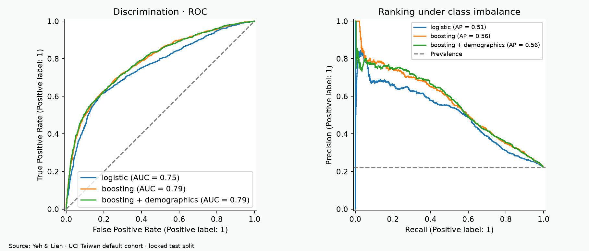
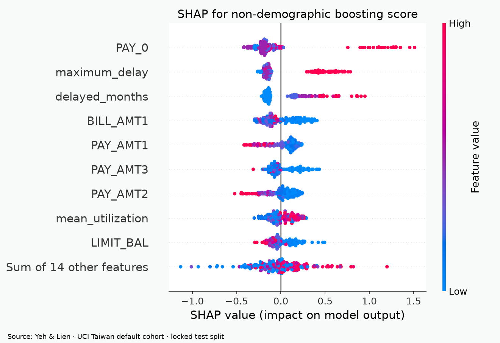
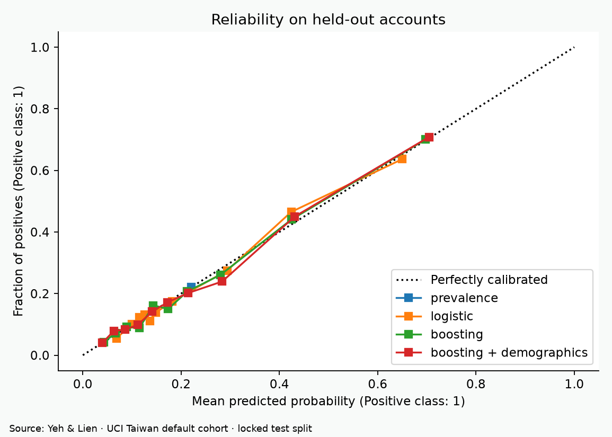
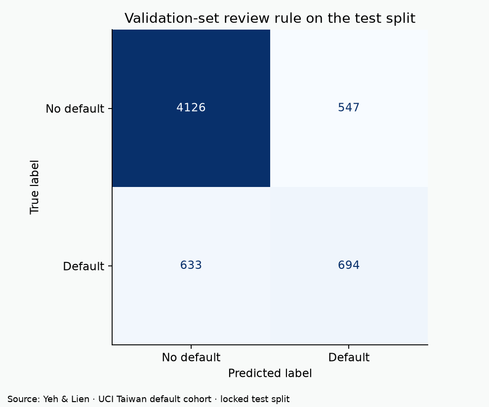
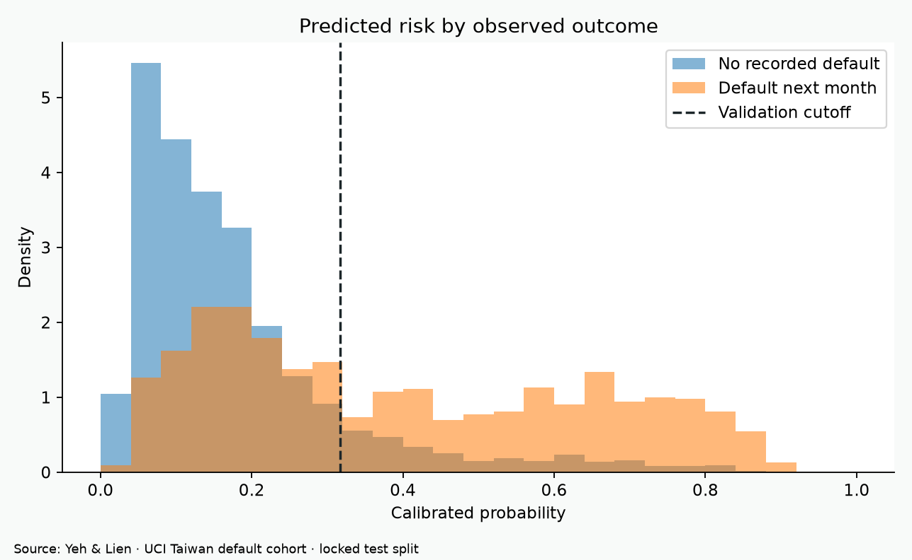
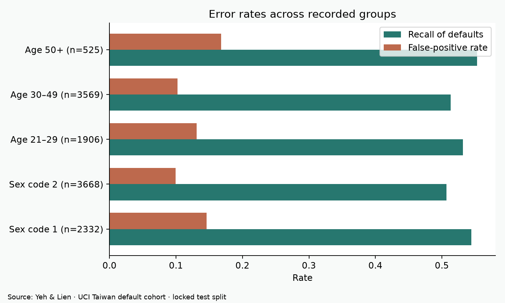
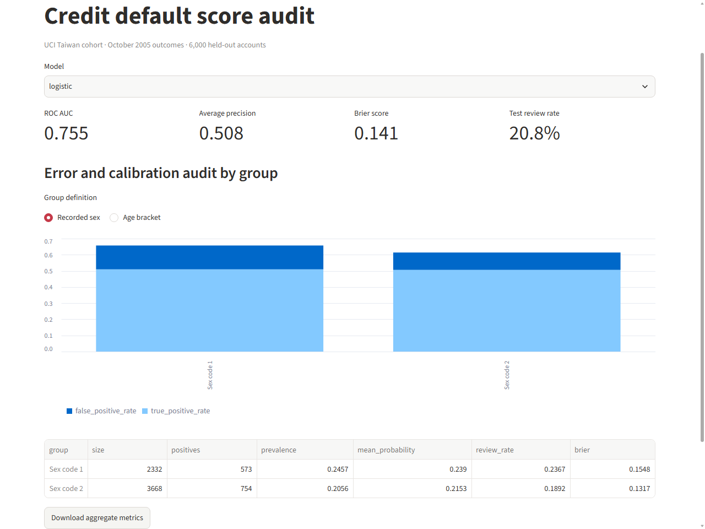

# Explainable Credit Risk Prediction

This benchmark asks how well historical credit-card account records rank next-month default and how resulting probabilities calibrate across recorded groups. The dashboard compares aggregate scores and error rates under a validation-set review threshold. The cohort describes Taiwan in 2005.



## Data and evaluation

The [UCI Default of Credit Card Clients dataset](https://archive.ics.uci.edu/dataset/350/defaultofcreditcardclients) contains 30,000 accounts. Credit Yeh and Lien under [CC BY 4.0](https://creativecommons.org/licenses/by/4.0/). The acquisition script verifies the UCI ZIP against a fixed SHA-256. The identifier and target never enter the models. We add usage ratios and delay summaries based on six available months. The main logistic and tree models exclude four recorded demographic fields. A second boosting run estimates how including them changes the benchmark.

The benchmark fixes a stratified 18,000 / 6,000 / 6,000 train, calibration and test split. A logistic recalibrator is fitted to validation-set logits. The validation split also chooses the quantile cutoff so approximately 20% would be reviewed. All test scores use the same 6,000 accounts. The constant-prevalence reference ties across all accounts, making its threshold-based error rates unsuitable for review-budget comparison.

## Test results

| Score | ROC AUC | Average precision | Brier ↓ | Default recall at validation cutoff |
| --- | ---: | ---: | ---: | ---: |
| Prevalence | 0.500 | 0.221 | 0.172 | — |
| Logistic | 0.755 | 0.508 | 0.141 | 50.8% |
| Boosting | 0.785 | 0.562 | 0.134 | 52.3% |
| Boosting with demographics | 0.786 | 0.560 | 0.133 | 53.4% |

The main boosting score flags 20.7% of test accounts. Adding demographics changes little on the selected ranking measures. Group prevalences and review fractions differ. The TreeSHAP values explain a sample of test predictions on the uncalibrated tree score scale.

| Question | Evidence |
| --- | --- |
| How well do probabilities agree with observed rates? | [Reliability plot](reports/figures/calibration.png) |
| How much do risks overlap? | [Score distribution](reports/figures/risk-distribution.png) |
| What happens at the operational cutoff? | [Confusion matrix](reports/figures/review-confusion.png) |
| How do errors vary by group? | [Subgroup audit](reports/figures/subgroup-errors.png) |
| Which inputs shift the tree score? | [SHAP](reports/figures/boosting-shap.png) |

## Reproduce

~~~powershell
python -m pip install -r requirements.txt
python study.py
python -m pytest -q
python -m streamlit run dashboard.py
~~~

The pipeline follows ZIP acquisition, validation, feature construction, fitting, calibration, held-out evaluation and rendering. [Metrics](reports/metrics.json) drive the review interface. The dataset offers no later cohort for temporal validation. Contemporary underwriting performance, fairness in other populations and the effect of taking a lending action remain open questions. [Executed notebook](notebooks/analysis.ipynb) · [Dashboard capture](reports/figures/dashboard.png)

<!-- RELEASE-GALLERY -->

## Architecture and technologies

Python builds fixed cohorts, compares scikit-learn models and calibration, computes SHAP diagnostics and publishes a Streamlit audit.

## Visualizations












[Executed notebook](notebooks/analysis.ipynb) · [Evaluation metrics](reports/metrics.json) · [Local QA](reports/QA.md)

## Application demo

```text
python -m streamlit run dashboard.py
```



## Future improvements

Evaluate calibration and review capacity on a recent external cohort before operational use.
